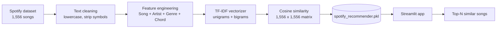

<div align="center">

# 🎵 Spotify Music Recommendation System

**A content-based music recommender built with NLP, TF-IDF and Cosine Similarity, served through an interactive Streamlit web app.**

[](https://www.python.org/)
[](https://streamlit.io/)
[](https://scikit-learn.org/)
[](https://pandas.pydata.org/)

[**Notebook**](Spotify%20Music%20Recommendation%20System.ipynb) · [**App Source**](Spotify-Music-Recommendation-System.py) · [**Report a Bug**](https://github.com/soumya0006/Spotify-Music-Recommendation-System/issues)

</div>

---

## 📑 Table of Contents

- [Overview](#-overview)
- [Features](#-features)
- [How It Works](#-how-it-works)
- [Tech Stack](#-tech-stack)
- [Project Structure](#-project-structure)
- [Getting Started](#-getting-started)
- [Usage](#-usage)
- [Sample Output](#-sample-output)
- [Limitations and Roadmap](#-limitations-and-roadmap)
- [Contact](#-contact)

---

## 📖 Overview

Music platforms host millions of tracks, which makes it hard for listeners to find songs similar to the ones they already love. This project tackles that problem with a **content-based recommendation engine**: it analyses the textual metadata of each song (title, artist, genre and chords), converts it into numerical vectors with **TF-IDF**, and ranks songs by **cosine similarity** to the track you pick.

The trained model is packaged as a single pickle file and served through a polished, Spotify-themed **Streamlit** interface.

| | |
|---|---|
| **Dataset size** | 1,556 songs |
| **Unique artists** | 716 |
| **Unique genres** | 394 |
| **TF-IDF features** | 5,263 (unigrams + bigrams) |
| **Similarity matrix** | 1,556 × 1,556 |

---

## ✨ Features

- 🎧 **Search and select** any song from the dataset using a searchable dropdown
- 🎯 **Adjustable results**: choose between 1 and 10 recommendations
- 📊 **Similarity score** shown as a percentage for every recommendation
- 🃏 **Song cards** and an expandable **table view** of the results
- ⬇️ **One-click CSV download** of your recommendations
- 🎨 **Custom Spotify-inspired dark theme** built with CSS
- 🛡️ **Input validation**: the app checks the model, matrix dimensions and required columns on startup

---

## ⚙️ How It Works



1. **Data exploration**: inspect shape, missing values, duplicates and top artists.
2. **Preprocessing**: keep `Song Name`, `Artist`, `Genre` and `Chord`, then clean the text.
3. **Feature engineering**: merge the four fields into one `combined_features` string.
4. **TF-IDF vectorisation**: weight terms by importance, with English stop words removed and `ngram_range=(1, 2)`.
5. **Cosine similarity**: compute pairwise similarity between every song.
6. **Recommendation**: sort by score, drop the selected song, return the top N.
7. **Deployment**: persist the artefacts with `pickle` and serve them via Streamlit.

---

## 🧰 Tech Stack

| Category | Tools |
|---|---|
| Language | Python |
| Data handling | Pandas, NumPy |
| Visualisation | Matplotlib, Seaborn |
| NLP / ML | scikit-learn (`TfidfVectorizer`, `cosine_similarity`) |
| Web app | Streamlit, custom CSS |
| Persistence | Pickle |

---

## 📂 Project Structure

Click any file name to open it directly on GitHub.

📦 **Spotify-Music-Recommendation-System**
- 🐍 [`Spotify-Music-Recommendation-System.py`](Spotify-Music-Recommendation-System.py) &nbsp;→&nbsp; *Streamlit web app*
- 📓 [`Spotify Music Recommendation System.ipynb`](Spotify%20Music%20Recommendation%20System.ipynb) &nbsp;→&nbsp; *Jupyter notebook (EDA, TF-IDF, similarity)*
- 🧠 [`spotify_recommender.pkl`](spotify_recommender.pkl) &nbsp;→&nbsp; *Saved model (data + TF-IDF + similarity matrix)*
- 📊 [`spotify_recommendations.csv`](spotify_recommendations.csv) &nbsp;→&nbsp; *Sample recommendation output*
- 📋 [`requirements.txt`](requirements.txt) &nbsp;→&nbsp; *Python dependencies*
- 📖 [`README.md`](README.md) &nbsp;→&nbsp; *Project documentation*

| File | Description |
|---|---|
| [`Spotify-Music-Recommendation-System.py`](Spotify-Music-Recommendation-System.py) | Streamlit web application (UI, validation, recommendation logic) |
| [`Spotify Music Recommendation System.ipynb`](Spotify%20Music%20Recommendation%20System.ipynb) | End-to-end notebook: EDA, preprocessing, TF-IDF, similarity, model export |
| [`spotify_recommender.pkl`](spotify_recommender.pkl) | Saved artefacts: cleaned data, TF-IDF vectorizer, TF-IDF matrix, similarity matrix |
| [`spotify_recommendations.csv`](spotify_recommendations.csv) | Example CSV exported from the app |
| [`requirements.txt`](requirements.txt) | Python dependencies |

---

## 🚀 Getting Started

### Prerequisites

- Python 3.10 or newer
- `pip`

### Installation

```bash
# 1. Clone the repository
git clone https://github.com/soumya0006/Spotify-Music-Recommendation-System.git
cd Spotify-Music-Recommendation-System

# 2. (Recommended) create a virtual environment
python -m venv venv
source venv/bin/activate        # Windows: venv\Scripts\activate

# 3. Install dependencies
pip install -r requirements.txt
```

### Run the app

```bash
streamlit run Spotify-Music-Recommendation-System.py
```

The app opens at `http://localhost:8501`.

### Re-train the model (optional)

1. Place your Spotify dataset (`spotify_dataset.csv`) in the project folder and update the path in the notebook's first data-loading cell.
2. Open [`Spotify Music Recommendation System.ipynb`](Spotify%20Music%20Recommendation%20System.ipynb) in Jupyter.
3. Run all cells. This regenerates `spotify_recommender.pkl`.

> **Note:** the pickle was created with scikit-learn `1.7.2`, which is pinned in [`requirements.txt`](requirements.txt) to avoid version-mismatch warnings.

---

## 💡 Usage

1. Choose a song from the **"Search and select a song"** dropdown.
2. Use the slider to pick how many recommendations you want.
3. Click **✨ Discover Recommended Songs**.
4. Browse the cards, open the table view, or **download the results as CSV**.

---

## 📊 Sample Output

Recommendations for **Olivia Rodrigo – good4u** (full file: [`spotify_recommendations.csv`](spotify_recommendations.csv)):

| Song Name | Artist | Genre | Similarity (%) |
|---|---|---|---|
| dejavu | oliviarodrigo | pop | 44.91 |
| favoritecrime | oliviarodrigo | pop | 44.91 |
| brutal | oliviarodrigo | pop | 44.91 |
| enoughforyou | oliviarodrigo | pop | 44.91 |
| 1stepforward3stepsback | oliviarodrigo | pop | 44.91 |
| driverslicense | oliviarodrigo | pop | 39.30 |
| jealousyjealousy | oliviarodrigo | pop | 39.30 |
| happier | oliviarodrigo | pop | 39.30 |

> Song names and artists appear in their cleaned form (lowercase, no spaces or symbols).

---

## 🔭 Limitations and Roadmap

**Current limitations**

- Recommendations rely on **metadata only** (title, artist, genre, chord), not on how a song actually sounds.
- Because the artist name is part of the text, songs by the **same artist rank highest**.
- Cleaning removes spaces, so multi-word titles become a single token, which limits word-level matching.

**Planned improvements**

- [ ] Hybrid model combining text features with audio features (danceability, energy, tempo)
- [ ] Spotify API integration for real-time data and album art
- [ ] Preserve word boundaries during text cleaning for richer TF-IDF tokens
- [ ] Collaborative filtering using user listening history
- [ ] Deploy to Streamlit Community Cloud and add a live demo link here

---

## 📬 Contact

**Soumya Ranjan Das**

[](https://www.linkedin.com/in/soumya-ranjan-das-660a1140b/)
[](mailto:your.email@example.com)
[](https://soumya0006.github.io/)
[](https://github.com/soumya0006)

- 💼 LinkedIn: [linkedin.com/in/soumya-ranjan-das-660a1140b](https://www.linkedin.com/in/soumya-ranjan-das-660a1140b/)
- 📧 Email: [sd5916111@gmail.com](https://mail.google.com/mail/?view=cm&fs=1&to=sd5916111@gmail.com&su=Hello%20Soumya)
- 🌐 Portfolio: [soumya0006.github.io](https://soumya0006.github.io/)

---

<div align="center">

If you found this project useful, please consider giving it a ⭐

</div>
